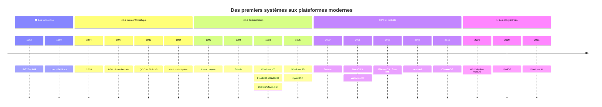
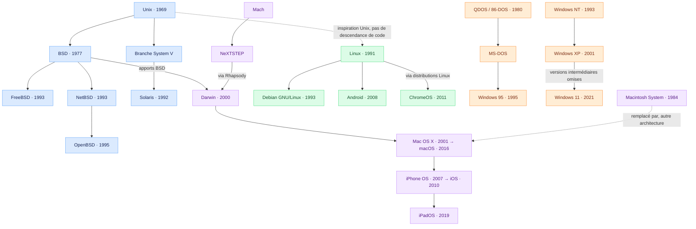

# 🖥️ L’ordinateur 

> **L’essentiel :** le matériel exécute, le firmware prépare le démarrage et le système d’exploitation gère les ressources.

## 🧩 1. Hardware — Le matériel

| 🧠 CPU | ⚡ RAM | 🔌 MB |
| :--- | :--- | :--- |
| **Processeur** | **Mémoire vive** | **Carte mère** |
| Exécute les instructions et réalise les calculs. | Stocke temporairement les données et programmes utilisés. | Relie les composants et permet leur communication. |
| *Central Processing Unit* | *Random Access Memory* | *Motherboard* |

> 💡 **Mémo :** CPU = calculer · RAM = garder à portée de main · MB = relier.
>
> La RAM perd son contenu lorsque l’alimentation est coupée.

## 🚀 2. Firmware — Préparer le démarrage

| Élément | À quoi sert-il ? |
| :--- | :--- |
| **BIOS / UEFI** | Firmware de la carte mère : initialise le matériel et lance le processus de démarrage. L’UEFI est le successeur du BIOS. |
| **POST** — *Power-On Self-Test* | Vérifications des principaux composants à la mise sous tension, exécutées par le BIOS / UEFI. |

### Du bouton d’alimentation au système

```text
       🔘 MISE SOUS TENSION
                │
                ▼
       ⚙️ BIOS / UEFI
       POST + initialisation
                │
                ▼
       📦 CHARGEUR DE DÉMARRAGE
                │
                ▼
       🖥️ SYSTÈME D’EXPLOITATION
```

## 🌉 3. HAL — Faire le lien avec le matériel

**HAL = Hardware Abstraction Layer** → couche d’abstraction matérielle.

Elle masque certains détails du matériel et fournit au système une interface commune pour y accéder.

> ⚠️ **À distinguer :** le BIOS / UEFI est du firmware ; le POST est une étape du démarrage. Ils ne constituent pas la HAL du système d’exploitation.

## 🖥️ 4. OS — Gérer l’ordinateur

**OS = Operating System** → système d’exploitation.

| Il gère… | Exemples |
| :--- | :--- |
| 🧠 Le processeur et les programmes | Répartition du temps de calcul |
| ⚡ La mémoire | Attribution de RAM aux programmes |
| 📁 Les fichiers et le stockage | Lecture, écriture et organisation |
| 🔌 Les périphériques | Clavier, écran, imprimante… |

**Exemples d’OS :** Windows · Linux · macOS

## 🗺️ Vue d’ensemble

*Schéma fonctionnel simplifié : la place exacte de la HAL et des pilotes dépend du système.*

```text
┌─────────────────────────────────────────┐
│             📱 APPLICATIONS             │
│      Navigateur, jeux, bureautique…      │
├─────────────────────────────────────────┤
│          🖥️ OS — SYSTÈME                 │
│      Gestion des ressources             │
│      Pilotes + HAL                      │
├─────────────────────────────────────────┤
│             🧩 HARDWARE                 │
│         CPU  +  RAM  +  Carte mère       │
└─────────────────────────────────────────┘
```

## 🎯 À retenir en 5 lignes

- **CPU** → exécute les instructions.
- **RAM** → conserve temporairement les données en cours d’utilisation.
- **Carte mère** → relie les composants.
- **BIOS / UEFI + POST** → initialisent et vérifient le matériel au démarrage.
- **OS + pilotes + HAL** → gèrent les ressources et l’accès au matériel. 

  <br>
  <br>
  <br>
  <br>
  <br>
  <br>
  <br>
  <br>
  <br>
  <br>
  
# 🖥️ Histoire des systèmes d’exploitation

> **Une sélection pour comprendre les grandes familles.** Cette frise simplifie l’arbre d’Eylenburg : elle ne reprend pas ses quelque 1 400 systèmes.

## ⏳ Les grandes étapes



**Lecture :** les années situent les jalons ; l’espacement entre eux n’est pas proportionnel au temps. Une proximité dans la frise ne signifie pas une filiation.

## 🌳 Qui descend de qui ?



**Légende :** 🔵 Unix / BSD · 🟢 Linux · 🟣 Apple / Mach · 🟠 DOS / Windows.

Les flèches pleines indiquent une filiation ou une contribution technique, parfois via des étapes omises. Les pointillés indiquent une inspiration ou un remplacement, précisé sur la flèche.

## 🎯 Trois repères pour réviser

- **Linux est un noyau** ; Debian est une distribution qui l’utilise. Android utilise également le noyau Linux.
- **macOS possède un héritage Unix**, avec Darwin, Mach et des apports BSD. Il ne prolonge pas simplement l’architecture du Mac OS classique.
- **Windows possède deux grandes lignées historiques** : DOS / Windows 9x et Windows NT. Windows XP et Windows 11 appartiennent à la lignée NT.

## 📚 Source et périmètre

Adaptation pédagogique en français de [Operating Systems: Timeline and Family Tree — Eylenburg](https://eylenburg.github.io/os_familytree.htm), avec ses [données sources](https://github.com/eylenburg/os-family-tree). Sélection, traduction et simplification des relations ; dates réduites à l’année. Les dates du projet peuvent correspondre à différents jalons : début d’un projet, annonce, diffusion ou changement de nom.
