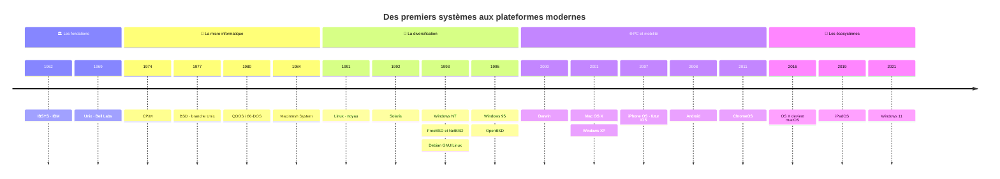
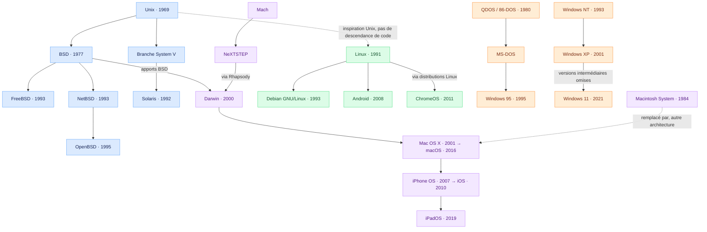

# 🖥️ L’ordinateur 

> **L’essentiel :** le matériel exécute, le firmware prépare le démarrage et le système d’exploitation gère les ressources.

## 🧩 1. Hardware — Le matériel

| 🧠 CPU | ⚡ RAM | 🔌 MB |
| :--- | :--- | :--- |
| **Processeur** | **Mémoire vive** | **Carte mère** |
| Exécute les instructions et réalise les calculs. | Stocke temporairement les données et programmes utilisés. | Relie les composants et permet leur communication. |
| *Central Processing Unit* | *Random Access Memory* | *Motherboard* |

> 💡 **Mémo :** CPU = calculer · RAM = garder à portée de main · MB = relier.
>
> La RAM perd son contenu lorsque l’alimentation est coupée.

## 🚀 2. Firmware — Préparer le démarrage

| Élément | À quoi sert-il ? |
| :--- | :--- |
| **BIOS / UEFI** | Firmware de la carte mère : initialise le matériel et lance le processus de démarrage. L’UEFI est le successeur du BIOS. |
| **POST** — *Power-On Self-Test* | Vérifications des principaux composants à la mise sous tension, exécutées par le BIOS / UEFI. |

### Du bouton d’alimentation au système

```text
       🔘 MISE SOUS TENSION
                │
                ▼
       ⚙️ BIOS / UEFI
       POST + initialisation
                │
                ▼
       📦 CHARGEUR DE DÉMARRAGE
                │
                ▼
       🖥️ SYSTÈME D’EXPLOITATION
```

## 🌉 3. HAL — Faire le lien avec le matériel

**HAL = Hardware Abstraction Layer** → couche d’abstraction matérielle.

Elle masque certains détails du matériel et fournit au système une interface commune pour y accéder.

> ⚠️ **À distinguer :** le BIOS / UEFI est du firmware ; le POST est une étape du démarrage. Ils ne constituent pas la HAL du système d’exploitation.

## 🖥️ 4. OS — Gérer l’ordinateur

**OS = Operating System** → système d’exploitation.

| Il gère… | Exemples |
| :--- | :--- |
| 🧠 Le processeur et les programmes | Répartition du temps de calcul |
| ⚡ La mémoire | Attribution de RAM aux programmes |
| 📁 Les fichiers et le stockage | Lecture, écriture et organisation |
| 🔌 Les périphériques | Clavier, écran, imprimante… |

**Exemples d’OS :** Windows · Linux · macOS

## 🗺️ Vue d’ensemble

*Schéma fonctionnel simplifié : la place exacte de la HAL et des pilotes dépend du système.*

```text
┌─────────────────────────────────────────┐
│             📱 APPLICATIONS             │
│      Navigateur, jeux, bureautique…      │
├─────────────────────────────────────────┤
│          🖥️ OS — SYSTÈME                 │
│      Gestion des ressources             │
│      Pilotes + HAL                      │
├─────────────────────────────────────────┤
│             🧩 HARDWARE                 │
│         CPU  +  RAM  +  Carte mère       │
└─────────────────────────────────────────┘
```

## 🎯 À retenir en 5 lignes

- **CPU** → exécute les instructions.
- **RAM** → conserve temporairement les données en cours d’utilisation.
- **Carte mère** → relie les composants.
- **BIOS / UEFI + POST** → initialisent et vérifient le matériel au démarrage.
- **OS + pilotes + HAL** → gèrent les ressources et l’accès au matériel. 

  <br>
  <br>
  <br>
  <br>
  <br>
  <br>
  <br>
  <br>
  <br>
  <br>
  
# 🖥️ Histoire des systèmes d’exploitation

> **Une sélection pour comprendre les grandes familles.** Cette frise simplifie l’arbre d’Eylenburg : elle ne reprend pas ses quelque 1 400 systèmes.

## ⏳ Les grandes étapes



**Lecture :** les années situent les jalons ; l’espacement entre eux n’est pas proportionnel au temps. Une proximité dans la frise ne signifie pas une filiation.

## 🌳 Qui descend de qui ?



**Légende :** 🔵 Unix / BSD · 🟢 Linux · 🟣 Apple / Mach · 🟠 DOS / Windows.

Les flèches pleines indiquent une filiation ou une contribution technique, parfois via des étapes omises. Les pointillés indiquent une inspiration ou un remplacement, précisé sur la flèche.

## 🎯 Trois repères pour réviser

- **Linux est un noyau** ; Debian est une distribution qui l’utilise. Android utilise également le noyau Linux.
- **macOS possède un héritage Unix**, avec Darwin, Mach et des apports BSD. Il ne prolonge pas simplement l’architecture du Mac OS classique.
- **Windows possède deux grandes lignées historiques** : DOS / Windows 9x et Windows NT. Windows XP et Windows 11 appartiennent à la lignée NT.

## 📚 Source et périmètre

Adaptation pédagogique en français de [Operating Systems: Timeline and Family Tree — Eylenburg](https://eylenburg.github.io/os_familytree.htm), avec ses [données sources](https://github.com/eylenburg/os-family-tree). Sélection, traduction et simplification des relations ; dates réduites à l’année. Les dates du projet peuvent correspondre à différents jalons : début d’un projet, annonce, diffusion ou changement de nom.  


  <br>
  <br>
  <br>
  <br>
  <br>
  <br>
  <br>
  <br>
  <br>
  <br>


# 🛠️ Cheatsheet — Commandes Windows + r

> **Ouvrir :** `Win + R` → saisir la commande → `Entrée`.
>
> 🔵 `.cpl` = réglages du Panneau de configuration · 🟣 `.msc` = consoles d’administration · ⚪ autres = outils ou chemins.

## 🔵 .cpl — Configuration

| Commande | Ouvre… | Utilité |
|---|---|---|
| `ncpa.cpl` | Connexions réseau | Gérer les cartes Ethernet / Wi-Fi et leurs propriétés IP / DNS. |
| `firewall.cpl` | Pare-feu Windows Defender | Consulter son état et autoriser une application. |
| `appwiz.cpl` | Programmes et fonctionnalités | Désinstaller les programmes classiques et accéder aux fonctionnalités Windows. |
| `mmsys.cpl` | Son | Configurer lecture, enregistrement et périphériques audio par défaut. |
| `powercfg.cpl` | Options d’alimentation | Choisir un mode de gestion de l’alimentation et régler la veille. |
| `sysdm.cpl` | Propriétés système | Accéder au nom du PC, aux performances, aux variables d’environnement et aux options de protection système. |

## 🟣 .msc — Administration

| Commande | Ouvre… | Utilité |
|---|---|---|
| `gpedit.msc` | Éditeur de stratégie de groupe locale | Configurer les stratégies utilisateur et ordinateur.¹ |
| `devmgmt.msc` | Gestionnaire de périphériques | Consulter le matériel et gérer les pilotes. |
| `diskmgmt.msc` | Gestion des disques | Gérer disques, partitions, volumes et lettres de lecteur. |
| `eventvwr.msc` | Observateur d’événements | Examiner les journaux, erreurs et avertissements. |
| `services.msc` | Services | Démarrer, arrêter et configurer les services Windows. |
| `compmgmt.msc` | Gestion de l’ordinateur | Regrouper plusieurs outils : événements, disques, services, etc. |
| `wf.msc` | Pare-feu avec fonctions avancées de sécurité | Gérer les règles entrantes / sortantes et les profils. |

## ⚪ Autres — Outils et dossiers

| Commande | Ouvre… | Utilité |
|---|---|---|
| `control` | Panneau de configuration | Accéder aux réglages classiques. |
| `regedit` | Éditeur du Registre | Consulter et modifier la configuration stockée dans le Registre. |
| `mstsc` | Connexion Bureau à distance | Se connecter à un ordinateur acceptant les connexions RDP. |
| `mmc` | Microsoft Management Console | Créer une console personnalisée et ajouter des composants logiciels enfichables. |
| `%temp%` | Dossier temporaire de l’utilisateur | Ouvrir le chemin défini par la variable d’environnement `TEMP`. |
| `cmd` | Invite de commandes | Exécuter des commandes et des scripts batch. |
| `cleanmgr` | Nettoyage de disque | Sélectionner des catégories de fichiers à supprimer pour libérer de l’espace. |

## 🧭 Quel outil choisir ?

```text
🌐 Réseau       → ncpa.cpl
🛡️ Pare-feu     → firewall.cpl : réglages courants
                 wf.msc       : règles avancées
📦 Programmes   → appwiz.cpl
🔊 Audio        → mmsys.cpl
🔋 Alimentation → powercfg.cpl
🔌 Matériel     → devmgmt.msc
💽 Partitions   → diskmgmt.msc
🔎 Diagnostic   → eventvwr.msc
⚙️ Services     → services.msc
🖥️ Accès distant → mstsc
🧹 Nettoyage    → cleanmgr
```

## 📝 À retenir

- **Corrections :** `devmgm.msc` → **`devmgmt.msc`** ; `mstmc` → **`mstsc`**.
- **¹ `gpedit.msc`** est disponible sur les éditions Pro, Entreprise et Éducation ; il n’est pas fourni avec l’édition Famille.
- **`.msc` et `mmc` :** un fichier `.msc` ouvre une console enregistrée ; `mmc` ouvre une console à personnaliser.
- **`%temp%`** est un chemin obtenu à partir d’une variable d’environnement, pas un programme.
- Certaines modifications nécessitent des droits administrateur. La présentation peut varier selon la version de Windows.


  <br>
  <br>
  <br>
  <br>
  <br>
  <br>
  <br>
  <br>
  <br>
  <br>

# ⌨️ Cheatsheet — Quotidien & technicien systèmes et réseaux

> **Environnement : Windows 11 / 10**, pour les usages quotidiens et le support du poste de travail.
>
> `Win` = ⊞ · `Maj` = Shift · `Suppr` = Delete · `Origine` = Home · `Fin` = End.
> Les touches reliées par `+` se pressent ensemble ; « puis » indique une séquence.
> Selon le portable, les touches F1–F12 nécessitent `Fn`. Les applications peuvent redéfinir certains raccourcis.

## ⭐ À apprendre en premier

| Besoin | Raccourci |
|---|---|
| Copier / coller | `Ctrl + C` / `Ctrl + V` |
| Annuler | `Ctrl + Z` |
| Changer d’application | `Alt + Tab` |
| Explorateur | `Win + E` |
| Verrouiller le poste | `Win + L` |
| Gestionnaire des tâches | `Ctrl + Maj + Échap` |
| Exécuter | `Win + R` |
| Capture ciblée | `Win + Maj + S` |
| Propriétés d’un fichier | `Alt + Entrée` |

## ✍️ 1. Texte et documents

*Raccourcis courants ; leur prise en charge dépend du logiciel.*

| Raccourci | Action |
|---|---|
| `Ctrl + X / C / V` | Couper / copier / coller |
| `Ctrl + A` | Tout sélectionner |
| `Ctrl + Z` | Annuler |
| `Ctrl + Y` | Rétablir, dans les applications compatibles |
| `Ctrl + S` | Enregistrer |
| `Ctrl + P` | Imprimer |
| `Ctrl + F` | Rechercher |
| `Ctrl + ← / →` | Se déplacer par mot |
| `Ctrl + Maj + ← / →` | Sélectionner par mot |
| `Origine / Fin` | Début / fin de ligne |
| `Ctrl + Origine / Fin` | Début / fin du document |
| `Maj + flèche` | Étendre la sélection |
| `Ctrl + Retour arrière` | Effacer le mot précédent |
| `Tab / Maj + Tab` | Champ suivant / précédent |
| `Échap` | Annuler ou fermer le menu courant |

## 🪟 2. Poste de travail et fenêtres

| Raccourci | Action |
|---|---|
| `Alt + Tab` | Basculer d’application |
| `Alt + F4` | Fermer la fenêtre active |
| `Win + D` | Afficher / masquer le bureau |
| `Win + ← / →` | Ancrer la fenêtre |
| `Win + ↑ / ↓` | Agrandir / restaurer ou réduire |
| `Win + Maj + ← / →` | Changer la fenêtre d’écran |
| `Win + Z` | Dispositions d’ancrage — Windows 11 |
| `Win + Tab` | Vue des tâches |
| `Win + Ctrl + D` | Nouveau bureau virtuel |
| `Win + Ctrl + ← / →` | Changer de bureau |
| `Win + Ctrl + F4` | Fermer le bureau ; déplacer ses fenêtres |
| `Maj + F10` | Menu contextuel |

## 📁 3. Fichiers et chemins réseau

| Raccourci | Action |
|---|---|
| `Win + E` | Explorateur |
| `Ctrl + Maj + N` | Nouveau dossier |
| `F2` | Renommer |
| `Alt + Entrée` | Propriétés |
| `Alt + ↑` | Dossier parent |
| `Alt + ← / →` | Précédent / suivant |
| `Alt + D` | Barre d’adresse |
| `Ctrl + E` | Recherche de fichiers |
| `F5` | Actualiser |
| `Ctrl + Maj + C` | Copier le chemin — Windows 11 |
| `Suppr` | Supprimer, généralement vers la Corbeille² |
| `Maj + Suppr` | Supprimer sans Corbeille² |

**Accès à un partage :** `Alt + D` → saisir `\\serveur\partage` → `Entrée`.

² Sur certains supports et emplacements réseau, la Corbeille n’est pas utilisée, même avec `Suppr`.

## 🌐 4. Navigateur — documentation et diagnostic web

*Repères Microsoft Edge ; beaucoup sont communs à Chrome et Firefox.*

| Raccourci | Action |
|---|---|
| `Ctrl + L` | Sélectionner l’URL |
| `Ctrl + T / W` | Ouvrir / fermer un onglet |
| `Ctrl + Maj + T` | Rouvrir l’onglet fermé |
| `Ctrl + Tab / Ctrl + Maj + Tab` | Onglet suivant / précédent |
| `Ctrl + F` | Chercher dans la page |
| `Ctrl + J` | Téléchargements |
| `Ctrl + H` | Historique |
| `Ctrl + Maj + N` | Fenêtre InPrivate — Edge |
| `Ctrl + Maj + V` | Coller sans mise en forme |
| `Ctrl + R` | Recharger |
| `Ctrl + Maj + R` | Recharger en ignorant le cache |
| `F12` ou `Ctrl + Maj + I` | Outils de développement |
| `F11` | Plein écran |
| `Ctrl + + / −` | Zoom |
| `Ctrl + 0` | Zoom à 100 % |

**Diagnostic web :** ouvrir les outils de développement → onglet **Réseau / Network** → recharger pour observer les requêtes, statuts HTTP et temps de réponse.

## 🛠️ 5. Support et administration du poste

| Raccourci | Action |
|---|---|
| `Ctrl + Maj + Échap` | Gestionnaire des tâches |
| `Ctrl + Alt + Suppr` | Écran de sécurité local |
| `Win + R` | Exécuter |
| `Win + X` | Menu d’administration rapide |
| `Win + I` | Paramètres |
| `Win + L` | Verrouiller |
| `Win + P` | Projection d’écran |
| `Win + U` | Accessibilité |
| `Win + V` | Historique du presse-papiers — activation nécessaire |
| `Win + Maj + S` | Capture de zone |
| `Win + Imp. écr.` | Capture complète enregistrée |

**Lancer un terminal administrateur :** ouvrir Démarrer → rechercher `cmd` ou `PowerShell` → `Ctrl + Maj + Entrée` → valider la demande d’élévation.

## 🧠 Mémo intervention

```text
POSTE LENT        → Ctrl + Maj + Échap
ERREUR À DOCUMENTER → Win + Maj + S
ADRESSE IP / DNS  → Win + R → ncpa.cpl
SERVICE EN PANNE  → Win + R → services.msc
JOURNAUX          → Win + R → eventvwr.msc
FIN D’INTERVENTION → Win + L
